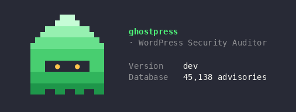
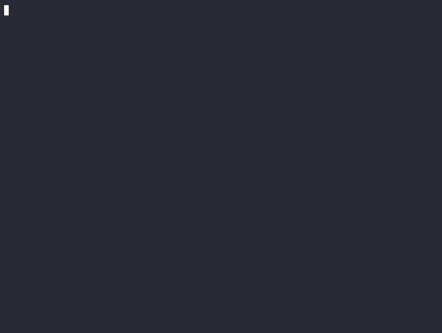

<p align="center">
  
</p>

<h1 align="center">ghostpress</h1>

<p align="center">
  A fast, portable WordPress security auditor in a single Go binary.<br>
  No runtime, no dependencies, no setup. Just drop it on a box and scan.
</p>

> [!WARNING]
> **Ghostpress is in early development.** It works and it is useful, but expect
> rough edges, the occasional false positive, and flags that may change before
> 1.0. If you hit a bug, please [open an issue](https://github.com/joda32/ghostpress/issues)
> with the command you ran and what you saw. Pull requests are very welcome too,
> whether it is a fix, a new check, or just better docs. This is the kind of
> project that gets better fast when people kick the tyres and tell us what broke.

---

## What it does

Ghostpress points at a WordPress site and tells you what is exposed: the core
version, the plugins and themes it can fingerprint, the users it can enumerate,
and crucially the known vulnerabilities that match. The vulnerability data comes
from the [Wordfence Intelligence](https://www.wordfence.com/threat-intel/) feed,
so you are matching against a real, maintained database of tens of thousands of
advisories rather than a hand-rolled list that went stale two years ago.

The whole database ships *inside* the binary, so a fresh download can scan
offline straight away. When you want the latest advisories, `ghostpress update`
pulls a fresh copy.

<p align="center">
  
</p>

## Why you might like it

- **One file.** Static Go binary. Copy it to a jump box or a CI runner and go. No Ruby, no gem install, no Docker required.
- **Offline-capable.** The advisory database is embedded, so you are not hitting a third-party API mid-scan (and nothing phones home).
- **Built for noisy, defended sites.** Detection is hardened against WAFs and soft-404s, so a site that lies about missing files does not turn into a wall of false positives.
- **Honest about confidence.** If it cannot confirm a component's version, it says so instead of dumping every CVE that ever applied. Use `--show-unconfirmed` when you want the maybes anyway.
- **Readable output.** Colourised CLI report for humans, JSON for your pipeline.

## Install

### Grab a prebuilt binary (easiest)

Head to the [Releases page](https://github.com/joda32/ghostpress/releases), grab
the binary for your platform, make it executable, and you are done:

```bash
chmod +x ghostpress
./ghostpress version
```

Move it somewhere on your `PATH` (for example `/usr/local/bin`) if you want to
call it as just `ghostpress`.

### Build from source

You will need Go 1.22 or newer.

```bash
git clone https://github.com/joda32/ghostpress.git
cd ghostpress
go build -o ghostpress .
./ghostpress version
```

To stamp a version into the build (so `ghostpress version` and the banner show
something nicer than `dev`):

```bash
go build -ldflags "-X main.version=v0.1.0" -o ghostpress .
```

## Quick start

Point it at a site:

```bash
ghostpress https://example.com
```

By default that enumerates plugins, themes, and users, then reports anything it
finds along with matching vulnerabilities. That is usually what you want.

The exit code tells your scripts how it went:

| Code | Meaning                                  |
|-----:|------------------------------------------|
| `0`  | Scan finished, nothing vulnerable found  |
| `1`  | Something went wrong (could not connect, bad target, and so on) |
| `5`  | Scan finished and found at least one vulnerability |

## Usage and examples

### Enumeration

Pick exactly what you want with `-e`. Combine options with commas:

```bash
# Only vulnerable plugins and vulnerable themes (fast, high signal)
ghostpress https://example.com -e vp,vt

# Everything interesting: all plugins, all themes, users, config backups
ghostpress https://example.com -e ap,at,u,cb
```

| Option | Checks for                                             |
|:------:|--------------------------------------------------------|
| `p`    | Popular plugins (built-in list)                        |
| `vp`   | Vulnerable plugins only                                |
| `ap`   | All plugins (full list, slower and louder)             |
| `t`    | Popular themes                                         |
| `vt`   | Vulnerable themes only                                 |
| `at`   | All themes                                             |
| `u`    | Users (author archives, REST, and friends)             |
| `cb`   | Exposed config backups (`wp-config` leftovers)         |
| `dbe`  | Database exports left lying around                     |
| `tt`   | TimThumb files                                         |
| `m`    | Media / attachment enumeration                         |

### Being quiet about it

Stealth mode uses a random user agent and sticks to passive detection, so it
makes far less noise:

```bash
ghostpress https://example.com --stealthy
```

You can also tune the aggression directly, throttle requests, and dial threads
up or down:

```bash
ghostpress https://example.com --detection-mode passive --throttle 250 -t 2
```

### Through a proxy, with auth

```bash
# Route everything through Burp or a SOCKS proxy
ghostpress https://example.com --proxy http://127.0.0.1:8080

# The target sits behind HTTP basic auth
ghostpress https://example.com --http-auth admin:secret

# Send a session cookie
ghostpress https://example.com --cookie-string "wordpress_logged_in_xyz=..."
```

### Password attacks

If you have enumerated users (or you bring your own), you can test credentials
against the login or XML-RPC:

```bash
# Try a wordlist against the users ghostpress already found
ghostpress https://example.com --passwords rockyou.txt

# Target specific users over XML-RPC multicall (faster, if it is enabled)
ghostpress https://example.com --passwords rockyou.txt \
  --usernames admin,editor --password-attack xmlrpc-multicall
```

### Machine-readable output

```bash
# JSON to a file for your pipeline
ghostpress https://example.com --format json -o scan.json
```

When you write to a file (or pipe the output), the colour and the ghost step
aside automatically, so you get clean plain text.

### When a site is behind a WAF

If version detection gets blocked, ghostpress will say so and tell you how many
requests were turned away. In that case the version of a component might be
unknown, and by default the matching advisories are held back (they may not
apply to whatever is actually installed). To see them anyway:

```bash
ghostpress https://example.com --show-unconfirmed
```

## Updating the vulnerability database

The binary ships with a database baked in, but new advisories land all the time.
Pull the latest with:

```bash
ghostpress update
```

That fetches the current database from the project's releases and verifies it
against a published checksum before replacing your local copy. If you host your
own mirror, point it somewhere else:

```bash
ghostpress update --url https://your.mirror/vulndb.json.gz
```

## A note on how detection works

Ghostpress leans on a few ideas to stay accurate on real sites:

- It fingerprints plugin and theme versions from readme and style files, and
  only reports version-specific vulnerabilities when it can actually confirm
  the version. No confirmation means the finding is held back (or flagged) rather
  than asserted.
- It treats ambiguous `200 OK` responses with suspicion, because plenty of sites
  and WAFs answer `200` for things that do not exist. HEAD requests and response
  shape are used to tell a real file from a soft-404.
- It caps how much it downloads when probing, so a scan does not balloon into
  pulling megabytes of homepage HTML per guess.

If something looks wrong, run with `-v` (debug) to see the per-request reasoning.

## Responsible use

Ghostpress is a tool for auditing systems **you own or are authorised to test**.
Scanning, enumerating users, or running password attacks against sites without
permission is very likely illegal where you live. Use it on your own lab, on
engagements with a signed scope, or on bug bounty targets that explicitly allow
it. You are responsible for what you point it at.

## Vulnerability data and attribution

The vulnerability database is built from the Wordfence Intelligence feed,
provided by Defiant Inc. Ghostpress preserves Wordfence's copyright and the
per-record references so that every finding links back to its source advisory.
Full details, including the data sources and their terms, are in
[`data/ATTRIBUTION.md`](data/ATTRIBUTION.md). Please read it before you
redistribute the database.

## Contributing

Early-stage projects live or die on feedback, so genuinely, do not be shy:

- **Found a bug or a false positive?** Open an issue with the command and the
  output. A screenshot or the JSON helps a lot.
- **Want a new check?** PRs for new plugin and theme detections, new enumeration
  modes, or better fingerprinting are all fair game.
- **Just here to improve the docs?** Also very welcome.

If you are sending a PR, keep changes focused and run `go test ./...` and
`gofmt` before you push.

## License

The ghostpress source code is released under the [MIT License](LICENSE).

The bundled vulnerability database is a separate matter: it is derived from the
Wordfence Intelligence feed and is governed by the terms described in
[`data/ATTRIBUTION.md`](data/ATTRIBUTION.md). Please read that before you
redistribute the database.
